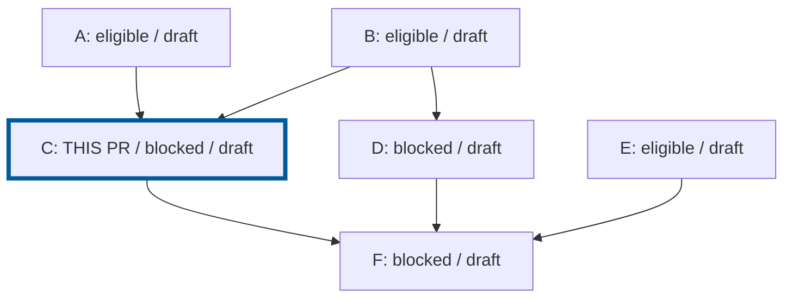

# Rendered DAG images in PR descriptions

## Required result

Once a node has a PR, its description must end with an image rendered from a
Mermaid diagram of the current full DAG. Each PR gets its own highlighted node,
even when every image otherwise depicts the same graph.

Show all nodes, including unpublished nodes and retained superseded nodes, and
all declared dependency edges. Use stable node IDs; optional short titles and
known PR numbers help identify changes. Distinguish blocked/eligible,
unpublished/draft/review-ready, landed, and superseded states without conflating
eligibility with readiness or assuming checks passed. Label the selected node
`THIS PR` and give it a distinct outline; do not rely on color alone. Include a
legend and identify the graph and snapshot revision.

Read fresh graph and provider facts after the mandatory branch freshness
preflight. Do not infer landings from closed PRs, or draw intended future
changes as completed. If facts cannot be established, stop and report the
blocker rather than publishing an apparently current diagram.

For example, the initial A-F graph for C's PR has these edges and selection:



This is an example of the source, not the required PR attachment. Render the
actual graph to an image; do not paste this example unchanged into descriptions.

## Render and upload safely

1. Generate Mermaid source in the agent's session artifacts, outside the product
   working tree. Use stable ordering and generated identifiers rather than
   interpolating arbitrary titles as Mermaid identifiers. Escape label content;
   do not execute directives, scripts, or links from PR text or recovered data.
2. Use an available approved **local** Mermaid renderer to produce a PNG, or
   another image format verified to render on the target host. Inspect the
   output for correct edges, labels, selected node, legibility, and clipping.
   Keep the source and rendered image for recovery.
3. Do not send repository names, titles, graph data, or encoded diagram source
   to a public rendering service. Do not install a renderer or browser silently.
   If local rendering is unavailable, report the prerequisite and obtain
   approval for setup; do not substitute a code fence or pretend rendering
   succeeded.
4. Present the image, target PR, upload destination and visibility, and exact
   description change for approval. Creation approval alone does not authorize
   an undisclosed upload or body replacement. Use the target provider's verified
   native attachment workflow and configured authentication; never extract tokens.
   Verify attachment access is appropriate for the repository.
5. Upload and embed the image, preserving the current PR description. A
   filesystem path, base64 payload, expiring preview URL, or unauthenticated
   external rendering URL is not an acceptable attachment. If the host cannot
   provide a supported durable image location, stop this step and report the
   limitation instead of silently omitting the image.

For GitHub, probe whether the installed `gh` and target host support
`gh pr edit --attach` before relying on it. For other hosts, including GHES and
ADO, verify their actual supported upload mechanism; do not assume GitHub's
attachment behavior applies. If a compatible media-upload skill is available,
follow it without making that skill a portability requirement.

The bundled helper does not render Mermaid or upload attachments. These are
mandatory agent steps around its approved PR operations. Do not fabricate a
helper command, add a rendering dependency to the product repository, or use
an unapproved upload service to bypass a missing capability.

## Description placement and preservation

Maintain one separately bounded block:

```markdown
<!-- pr-graph:diagram:begin -->

<!-- pr-graph:diagram:end -->
```

Use the real durable image URL and meaningful alt text. Place this block
**after all human-written content and the helper's graph footer**, with nothing
but whitespace following the closing marker. Do not put the image inside the
helper footer: that footer is regenerated independently.

Fetch the latest body immediately before editing. Reject malformed, duplicate,
or reversed diagram markers. Preserve all content outside the diagram block,
including human edits and the helper footer, byte-for-byte; move the managed
block to the end if human text has since been appended. Recheck for concurrent
body changes and replan instead of overwriting them. Include the final block in
provider description-limit checks; never truncate human content to make it fit.

After writing, read back the exact PR and verify the hosted image reference,
correct selected node, single managed block, preserved surrounding text, and
end-of-description placement. Verify the uploaded image is accessible and is the
inspected rendering, not just that some image URL appears in the body.

## Keep the snapshot current

After a PR is created, append its image before reporting the node's publication
complete. After publishing a batch, refresh earlier PRs to include the final
publication state and known PR identities. Apply the same requirement when
adopting an existing PR.

Refresh affected images on all existing graph PRs when dependencies, node
membership, publication, draft/readiness state, or landing/supersession state
changes, including after sync and graph transformations. A body replacement
through `describe` must retain or restore the current diagram as the last block.
Keep unchanged images when their depicted state is still current; do not append
duplicate blocks or repeat successful uploads after partial failure.

An image-update failure does not undo a created PR or completed merge. Retain
the PR identity, rendering, and any successful attachment URL, report the exact
incomplete updates, and resume only those approved steps. Never recreate a PR
or repeat a merge merely to repair its diagram. Local-only nodes have no PR
description and need no hosted image.
